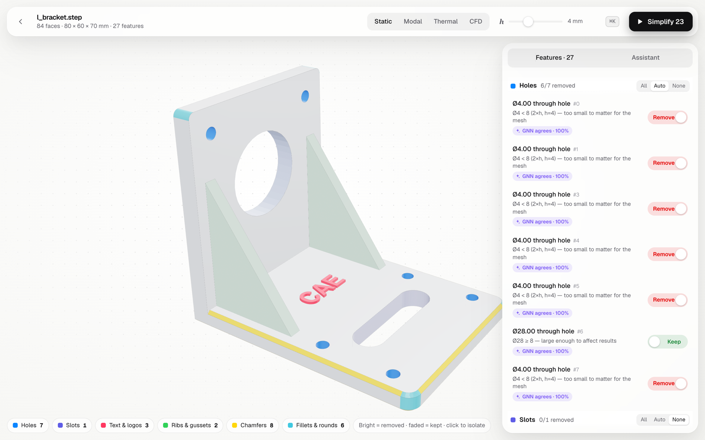
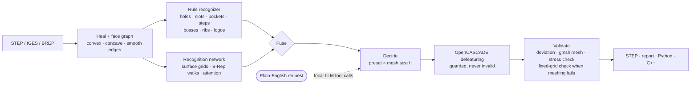

<div align="center">

# DeFeat

### Simulation-ready CAD, in a sentence.

DeFeat takes a mold-part STEP file and finds its holes, slots, pockets, bosses, ribs, logos, fillets and chamfers.<br>
It decides what matters for your analysis and removes the rest. Then it **checks the result**: both models are meshed and the same four load cases are solved on each.


<picture>
  <source media="(prefers-color-scheme: dark)" srcset="docs/images/welcome-dark.png">
  
</picture>

<sub>The hero is a live dot-matrix render of a real part. Highlighted dots are the features DeFeat will remove; they dissolve away to show the simulation-ready result.</sub>

</div>

## What you get

<table>
<tr>
<td width="50%"><b>Before / after, side by side</b><br><sub>Drag the wipe line to compare the original and simplified model.</sub><br><br>
<picture><source media="(prefers-color-scheme: dark)" srcset="docs/images/compare-dark.png"></picture></td>
<td width="50%"><b>Checked, not assumed</b><br><sub>Mesh elements, geometric deviation and a four-case static stress check on both models, plus a STEP, a report and code to download.</sub><br><br>
<picture><source media="(prefers-color-scheme: dark)" srcset="docs/images/results-dark.png"></picture></td>
</tr>
<tr>
<td width="50%"><b>Every feature, explained</b><br><sub>Colour-coded by class, with a plain-English keep/remove reason and the network's second opinion. Click a chip to isolate a class, or press <kbd>⌘K</kbd> for the command palette.</sub><br><br>
<picture><source media="(prefers-color-scheme: dark)" srcset="docs/images/features-dark.png"></picture></td>
<td width="50%"><b>Talk to your part</b><br><sub>A local open-source LLM turns plain English into exact tool calls. No CAD skills needed, and nothing leaves the machine.</sub><br><br>
</td>
</tr>
</table>

**Outputs:**
- a simplified **STEP**
- an HTML/PDF **report**
- a standalone **Python** script and **C++** program that reproduce the result from the original file. The Python one is round-trip verified.
- an optional CFD **fluid domain**

## Videos

- **Intro** (95 s): `docs/videos/defeat-intro.mp4`
- **Walkthrough** (175 s): `docs/videos/defeat-walkthrough.mp4`

Both are built entirely from code and open models. The narration is [Kokoro](https://github.com/thewh1teagle/kokoro-onnx) (open weights, runs offline). The picture is [Remotion](https://www.remotion.dev), with real 3D parts rendered in three.js. The original 96 BPM score and every sound effect are synthesised in Python. The intro's showcase parts are modelled for the film in `video/parts.py`: a mold cavity plate, gearbox cover, flanged hub, heat sink and robot-arm link, alongside the two samples. `video/export_mesh.py` runs DeFeat on each and exports the original and simplified meshes, so every orange face that lifts away on screen is one DeFeat actually removes. The script and its timing live in `video/plan.json`. `video/score.py` places each line on the bar grid, ducks the music under the voice and writes the timing to `video/src/cues.ts`, so the voice, cuts and captions land on the same frame. To rebuild them:
```bash
cd video
python3.11 -m venv .tts && .tts/bin/pip install kokoro-onnx soundfile   # plus the two model files in video/tts_models/
../.venv/bin/python parts.py && ../.venv/bin/python export_mesh.py       # showcase parts + meshes
.tts/bin/python voice.py && ../.venv/bin/python score.py                 # narration, then score + mix
../.venv/bin/python capture.py                                           # app captures (app running)
npm install && npm run render:intro && npm run render:guide
```

## How it works



| Stage | Module | What it does |
|---|---|---|
| Ingest | `occ.py` | Reads STEP/IGES/BREP, heals the shape with ShapeFix, and indexes faces stably |
| Face graph | `graph.py` | Builds a face-adjacency graph with exact convex/concave/smooth edges (material-side rule on the edge's 2D curve) |
| Rules | `recognize.py` | Inner-loop flood fill finds holes, slots, pockets, bosses and embosses. Concave-edge regions find steps and open channels. Also detects thin-wall ribs and gussets, blend chains and chamfers |
| Network | `net.py`, `brepfeat.py` | Two models, averaged. Each face is described by a 10×10 grid of points and normals sampled on its surface (the UV-Net idea) and each edge by a sampled curve. Winged-edge walks around every coedge pass information through the B-Rep topology (the BRepNet idea). Two layers of face self-attention let distant faces of the same part inform each other, and part-wide context and the rule recognizer's guesses are inputs too. One head predicts DeFeat's classes, a second predicts the Fusion 360 Gallery's eight modelling labels. 2.8–2.9 million parameters per model; the second model drops the surface grids, so the pair disagree in useful ways |
| Fuse | `recognize.py` | The network confirms or vetoes rule fillets and chamfers, adds the ones the rules miss, and fills in steps and cut-outs the rules can't see. Its cut-history head marks small cut-outs only: a large design cut is part of the shape, not a feature to remove. Every threshold was tuned on validation parts |
| Decide | `decide.py` | Presets for static, modal, thermal and CFD. Thresholds are multiples of the target mesh size *h*, because a feature only hurts the mesh when it's small relative to the elements. When the stress check will run, it judges what can go, so nothing is held back up front. Without it, a volume budget keeps the total change small |
| Execute | `execute.py` | `BRepAlgoAPI_Defeaturing` (run in parallel) inside a killable worker process, so hangs and native crashes are contained. It tries a single pass first, then goes feature by feature, then retries a refused blend with its tangent neighbours. Features are tracked exactly through each removal using the kernel's own history, and a feature counts as removed only when that history shows every one of its faces deleted. A boss or hole takes its own edge blends and chamfers with it (a dowel's tip chamfer, the blend at a blind hole's bottom), and any refused feature is retried with the tangent sliver faces around it. A removal that adds or takes away more material than its feature could account for is rejected |
| Speed | `validate.py`, `session.py` | The original part's mesh and stress solve depend only on its geometry, mesh size and loads, never on what is removed. The app starts it in a background process as soon as a part is opened, keeps it for every run and every stress-guard re-check, and starts the original's finer confirmation solve as soon as a result lands near the limit, so a run usually only has to solve the simplified part |
| Mesh | `validate.py` | Deterministic gmsh meshing of both models at the same *h*. When gmsh can't mesh the CAD surfaces, DeFeat re-meshes from a watertight OpenCASCADE triangulation of the part before it ever coarsens the mesh, so awkward real parts still get checked at the working size |
| Grid check | `immersed.py` | For a part neither gmsh route can mesh, the stress check runs on a fixed grid instead (the finite cell method). The part is placed in about 2,500 regular cells with quadratic elements; generalized winding numbers decide what is inside, and in the cells the surface cuts through, integration weights are fitted so the cut volume and its moments come out exact. No mesh of the part is needed, so self-touching and non-manifold surfaces are fine. It is slower and more cautious than the tetrahedral check, so it uses a tighter 3% tolerance |
| Validate | `validate.py`, `fea.py`, `sensitivity.py` | Surface deviation, a linear static solve on both meshes (scikit-fem, quadratic tetrahedra, four load cases) and a **stress guard**. The working mesh can now be 45,000 elements instead of 17,000 (the old cap left stiffness about 2.5% short of converged). Up to 250,000 unknowns one sparse LU factorization serves all four load cases; beyond that, for the finer meshes of the convergence check, smoothed-aggregation algebraic multigrid (pyamg) with the six rigid-body modes as its near-null space takes over. It matches the direct solver to 1e-12 and uses memory linear in the mesh. Multigrid isn't used below that size because on thin-walled parts it needs about 200 iterations per load case, which made it slower than a single factorization. When a load case moves more than 5% (for the static preset: deflection or peak stress), it prices each removed feature by the stress field around it, puts back the costliest first, and bisects to keep as many removals as stay within tolerance |
| Export | `codegen.py` | Python (OCP) and C++ (OCCT) programs that replay the exact kernel calls the app made, in order: each face is found once in the original file by its geometric signature, then followed through every call by the kernel's history. The Python script reproduces the app's result to 1e-12 in volume on the samples; the C++ program uses the same calls but hasn't been compiled on this release |
| Assistant | `agent.py`, `server.py` | Ollama tool calling (`qwen3.5:4b`) with a keyword fallback that needs no model. Every proposed call is **verified against the sentence** before it runs: negation and verbs such as *fill*, *plug* and *suppress* decide keep vs. remove, classes the model missed are added, classes the user never mentioned are dropped, and questions run nothing. Sandboxed text-to-CAD (CadQuery) measures every candidate it builds against the request, repairs from the measured error, and picks among several candidates by fewest mismatches, then by agreement with the others |

## Benchmarks

Every number below is measured on **held-out test data that was never used for training or tuning**, unless a line says otherwise. Each test set was scored once, after every choice had been made on validation parts. The raw results are in [`bench/results/`](bench/results/), and every benchmark can be re-run (see *Reproduce*). Hardware: a CPU-only laptop. "Precision" means: of the faces DeFeat flags, how many are right. "Recall" means: of the true feature faces, how many DeFeat finds. Intervals are 95%: Wilson score intervals for rates, and a 2,000-sample bootstrap that resamples whole parts (faces of one part aren't independent) for everything else.

### Recognition

<picture>
  <source media="(prefers-color-scheme: dark)" srcset="docs/images/chart-fusion-dark.png">
  
</picture>

| Fusion 360 Gallery: the whole test split, 6,454 real designer parts (139,200 faces) | Rules only (P / R / F1) | Network only | **Shipped: rules + network** |
|---|---|---|---|
| Fillets | 0.60 / 0.88 / 0.71 | 0.98 / 0.99 / 0.99 | **0.985 / 0.991 / 0.988** (0.979–0.994) |
| Chamfers | 0.71 / 0.53 / 0.61 | 0.96 / 0.97 / 0.97 | **0.993 / 0.947 / 0.969** (0.957–0.979) |

- The shipped column is the app's own code path (`defeat.recognize.refine_with_net`), not a separate benchmark copy. It takes 1.8 s per part, including reading the STEP file.
- The previous release scored fillet F1 0.87 and chamfer F1 0.82 on half of these parts. The new network cuts the error about tenfold on fillets and sixfold on chamfers.
- Fusion's "cut" label records how a face was modelled, not whether it is a small feature. The network's own eight-label head gets cut faces right at F1 0.92. The shipped path scores 0.69 against that label on purpose: it only marks cut-outs that are small enough to remove.

**Eight-label segmentation**, the measure used in published work on this dataset. These are the network's own predictions on 6,449 test parts:

| Model | Accuracy | Mean IoU |
|---|---|---|
| **DeFeat, two-model ensemble** | **94.95%** (94.39–95.46) | **81.2%** (79.4–83.8) |
| DeFeat, the same model with only B-Rep walks | 94.51% (93.88–95.06) | 80.3% (78.4–82.3) |
| BRepNet, published | 92.52% | 77.10% |
| BRT (B-rep transformer), published | 90.47% | 70.16% |
| UV-Net, published | 89.03% | 66.47% |

- The published numbers use version s2.0.0 of the dataset. DeFeat is scored on the s2.0.1 extended-STEP release of the same official split, so the comparison is close but not exact.
- The walks-only row is DeFeat's own BRepNet-style model trained the same way, and it already beats the published BRepNet. So most of the gain probably comes from training data and the dataset version rather than the architecture. The ensemble adds a further gain inside overlapping intervals.
- Rotating every test part at random gives the same score (94.98%, 81.3%), so the network doesn't depend on how a part is oriented.
- IoU by label: Fillet 0.98, ExtrudeSide 0.93, Chamfer 0.93, ExtrudeEnd 0.88, RevolveSide 0.87, CutSide 0.85, CutEnd 0.74, RevolveEnd 0.32. RevolveEnd is rare and is usually indistinguishable from an extrude end.

<picture>
  <source media="(prefers-color-scheme: dark)" srcset="docs/images/chart-mfcad-dark.png">
  
</picture>

| MFCAD: all 3,122 test parts (70,850 faces) | Rules only (P / R / F1) | Network only | **Shipped: rules + network** |
|---|---|---|---|
| Feature vs. body | 0.98 / 0.91 / 0.95 | 1.00 / 1.00 / 1.00 | **0.98 / 0.94 / 0.96** |
| Cut-outs (slots, passages, pockets) | 0.84 / 0.82 / 0.83 | 0.96 / 1.00 / 0.98 | **1.00 / 0.98 / 0.99** |
| Steps / shoulders | 0.41 / 0.33 / 0.37 | 0.93 / 1.00 / 0.96 | **1.00 / 0.93 / 0.96** |

- MFCAD's parts all come from one generator, so train and test look alike, and the network alone is near-perfect. Fusion 360 is the harder, more honest test.
- Steps went from F1 0.89 to 0.96 against the previous release, and cut-outs from 0.98 to 0.99.
- Feature vs. body dropped from 0.99 to 0.96 because of MFCAD's "chamfer" class. It is a large bevel cut, not an edge chamfer, and the shipped path keeps 2,383 of its 2,622 faces as body: a bevel that size is part of the shape. It isn't retuned, because that would mean tuning on the test set.

### The full pipeline on real parts

<picture>
  <source media="(prefers-color-scheme: dark)" srcset="docs/images/chart-robust-dark.png">
  
</picture>

The run uses 500 Fusion 360 test parts that none of the other benchmarks or tuning runs touched, with a 40-minute limit per part. Version 1.1 was scored on a fresh set of 500 (the earlier set had been seen while building it), so the two runs are different parts.

| Full pipeline on 500 fresh real parts | Result |
|---|---|
| Parts completed | **500 / 500** (99.2–100%) |
| Output is a valid solid | **100%** (99.2–100%) |
| Targeted features the kernel removed | **89.6%** (83.5–94.3%). The rest are kept and reported, never broken |
| Within 5% on all four load cases, after the guard (197 parts) | **100%** (98.1–100%). This is what the guard enforces; see below |
| Median worst load-case change (same 197 parts) | **0.69%** (0.40–0.83%), 90th percentile 3.2% |
| Median change in deflection / peak stress | 0.16% / 0.19%, 90th percentile 1.9% / 2.2% |
| Faces removed / volume change | median 8.4% / 0.10% |
| Mesh elements removed (197 parts) | median 1.2%, 90th percentile 41% |
| Time per part | median 1.7 s, 90th percentile 188 s (this includes meshing and solving both models) |

206 of the 500 parts had something to remove; the other 294 have no features worth removing and are returned as they were. Where every targeted feature went:

| 1,327 targeted features | Count |
|---|---|
| Removed, and still gone in the final part | **618** |
| Put back by the stress guard | 356 |
| Refused by the kernel, kept and reported | 138 |
| Kept because no stress comparison came back, so only the volume-budget removals were allowed | 215 (110 of them on one part) |

- **Correction to the removal counts above.** This run counted a feature as removed when the face count dropped. An audit on 300 validation parts found that a single kernel pass can lower the face count while a blend stays in place: 35 features on 12 of 136 parts were reported removed but were still there, overstating reported removals by about 7.7%. The counts above come from that version. The current release only counts a feature as removed when the kernel's history shows all its faces deleted, and retries the rest one by one. The validity, completion and stress-check results are unaffected, since they were measured on the actual output parts.
- **Parts without a stress comparison: 9 of 206, down from 16 of 220 on the earlier run.** Seven have surfaces gmsh can't mesh by either route and one was too heavy for this laptop. One comes out unchanged; the others keep only small volume-budget removals, and the app tells the user plainly that the part has no stress check.
- **What closed the gap:** 52 parts were meshed through the triangulation route after the CAD-surface mesher failed, at the working mesh size rather than a coarser one. Parts where removing an end feature used to wipe out the clamped or loaded region now keep those features and are checked; on the earlier run two parts were lost that way, here none.
- **Measured before two last fixes**, which were found on the printer chassis after this run and so can't have been tuned on it: a mesh round that times out now skips straight to a coarser mesh instead of retrying at the same size, and meshes up to the 45,000-element cap use one LU factorization instead of multigrid. Both only affect parts that were running out of time, so the numbers above are, if anything, conservative.
- **The median mesh reduction is modest because most real parts have little to remove,** and the guard puts back whatever moves a load case. On parts with real features the cut is large: the 90th percentile is 41%, and on the worked examples below it is about half.

**The stress check:** the last 5% of the part's volume at one end of its long axis is clamped, and the same share at the other end carries the load: bending about both axes, tension and torsion. Both regions are fixed on the original and reused unchanged for the simplified model, so removing something right at an end can't change the test. You can choose your own supports and loads in the app instead. The solver matches CalculiX given the same meshes, supports and loads (40 parts tried, one too large and one timed out; median difference 0.0000003%, largest 0.000006%), and beam theory on a cantilever to within 0.3%.

**What the stress guard prevented:**
- DeFeat removes everything the physics might allow and lets the check decide, so the guard does real work: before it, 47.7% (40.9–54.7%) of the 197 parts were within 5% on every load case.
- It triggered on 103 parts. On 59, putting some features back was enough (a median of 2). On 44 every removal was undone, so those parts come out unchanged. These are mostly tiny parts where the only "feature" is structural.
- After the guard all 197 parts are within 5%. That is what the guard enforces, not an independent result; the mesh check below is the independent one.

**Does the answer depend on the mesh?** Measured on validation parts with the 1.0 working mesh, comparing it with one twice as fine, before any guard. The 1.1 working mesh is up to 2.6× larger, so this is the more pessimistic case. Only parts small enough for the finer mesh to fit the solver can be checked: 55 of the parts with something removed.

| Mesh check | Result |
|---|---|
| Same unchanged part at *h* and 0.9 *h* (the check's own noise, 68 parts) | median 0.85%, 90th percentile 3.8% |
| Change from defeaturing, working mesh vs. finer mesh | median difference 0.78 points, 90th percentile 3.4 |
| Both meshes agree on the within-5% verdict | **92.7%** (82.7–97.1%), 51 of 55 |
| Passed on the working mesh, failed on the finer one | **3 of 42** (at 5.1%, 6.0% and 9.8%) |

So a pass is strong evidence, not a guarantee. Treat anything close to 5% as a reason to look.

**When gmsh can't mesh the part: the grid check.** Calibrated on validation parts against the tetrahedral check, both run with the same load cases and end regions (75 parts, 19 with something removed and both checks available):

| Grid check vs. tetrahedral check | Result |
|---|---|
| Difference per load case | median 0.2 points, 90th percentile 4.6 |
| Parts the tetrahedral check fails at 5% that the grid passes | **0 of 5**, at every grid tolerance from 2% to 5% |
| Tetrahedral passes the grid also passes, at its 3% tolerance | 79% (52–92%) |
| Part volume on the grid | median error −0.26% |
| Time | median 316 s, against 23 s for the tetrahedral check |

So the grid mostly errs toward caution: it never let through a part the regular check would fail, and it keeps about four in five of the removals the regular check would keep. It only runs when meshing has failed, so its cost lands on the parts that would otherwise get no check at all.

**Worked examples** (bundled samples, static preset):

| Part | Removed | Faces | Tetrahedra | Worst load case | Stress guard |
|---|---|---|---|---|---|
| L-bracket | 20 / 27 | 84 → 22 | **−46%** | 3.8% | saw 7.8%, put 2 features back |
| Printer chassis | 21 / 31 | 261 → 105 | **−42%** | 3.3% | not needed |

Both are checked on the larger working mesh (the chassis's is 46,000 elements) and re-measured for this release. The bracket now really removes its blends and chamfers (earlier releases reported 22 removed while leaving 6 blend faces in place, ending at 32 faces), so its removals matter more: the guard saw 7.8% and put 2 back. The chassis's 0.6% in the previous README was out of date: release 1.1 itself gives 3.3% (bending about the wide axis), the same as now.

### Real parts from open collections (not used for training or tuning)

DeFeat run end to end, exactly as the app runs it, on openly licensed real parts it had never seen: the 21 NIST engineering test parts, 60 random parts from the FreeCAD library's mechanical and industrial-design folders, and 60 KiCad connector and switch models (mostly injection-molded housings). No face labels exist for these, so this measures what a user sees rather than recognition accuracy. See [`docs/open-cad-datasets.md`](docs/open-cad-datasets.md) for the licenses.

| | NIST | FreeCAD | KiCad |
|---|---|---|---|
| Parts opened | 20 of 21 (one crashed the kernel) | 60 of 60 | 60 of 60 |
| With something to remove | 18 | 14 | 54 |
| Output is a valid solid | all | all | all |
| Targeted features removed | **44%** (264 of 599) | **40%** (235 of 588) | **49%** (719 of 1,468) |
| Within 5% on every load case, where the stress check ran | all | all | all |
| Median time per part, with the stress check | 7.0 min | 6.5 min | 3.7 min |

This is the weakest result in this README, and the one closest to everyday use. DeFeat never handed back a broken part or a part that moved a load case by more than 5%, but on real parts it removed only 40–49% of what it targeted. The rest are kept and reported for three reasons: the part's time budget for removals runs out on large parts (the two largest NIST parts, 484 and 637 faces, had nothing removed), the kernel returns the part unchanged, or the kernel's rebuild is refused because it changed far more material than the feature holds. On one NIST part, removing a single 6 mm hole made OpenCASCADE drop an unrelated face 75 mm away and fill about 30% of the part; the check refuses that, correctly. Making removal hold up on such parts is the next piece of work.

### Assistant

Scored on a fourth held-out set ([`bench/heldout_v4.py`](bench/heldout_v4.py)): 80 commands and 40 part descriptions, written before any of this release's assistant changes were run on them. "Before" is the previous release on the same set, "after" is this one. Each was scored once.

| 80 held-out commands, tool calls exactly right | Before | After |
|---|---|---|
| Local LLM (`qwen3.5:4b`, offline) | 77.5% (67.2–85.3%), F1 0.86 | **96.3%** (89.6–98.7%), F1 0.98 |
| Keyword fallback (no model) | 80.0% (70.0–87.3%), F1 0.89 | **97.5%** (91.3–99.3%), F1 0.99 |
| Median time per command (LLM) | 54 s | 32 s |

| Text-to-CAD: 40 held-out part descriptions (`qwen3.5:4b`) | Before | After |
|---|---|---|
| Produces a valid solid | 92.5% (80.1–97.4%) | **100%** (91.2–100%) |
| Within 10% of the requested dimensions | 90.0% (77.0–96.0%) | **95.0%** (83.5–98.6%) |
| Median time | 107 s | 57 s |

- What changed: every call the model proposes is checked against the sentence before it runs (see *How it works*), and text-to-CAD now repairs from measured dimensions and picks among candidates instead of trusting its first answer.
- The LLM's earlier score of 93.8% on the third held-out set did not carry over: the same model scored 77.5% on this fresh set. That gap is why each set is now used once and then retired. The earlier sets (96 development and 80 third-set commands) are development data now; the keyword fallback gets all 176 right.
- Remaining misses: "remove everything small *except* the holes" still removes the holes, "I'll run a stress analysis" also starts a run, and "set it up for flow simulation" also builds a flow domain. The two text-to-CAD misses are a T-bar and a ribbed base plate, both built at the wrong height.
- One gold answer in the third set was wrong (an 80 mm pentagon measures 76.1 × 72.4 mm, not 80 × 76.1) and is corrected.

**Training data:** each network learns from 43,698 parts:
- **34,908 Fusion 360 Gallery training parts** (731,417 faces, all eight labels), the official train split minus 1,499 parts held back for validation
- **6,000 MFCAD training parts**
- **2,790 procedurally generated mold parts** with exact labels for logos, bosses, ribs and pockets

The rule recognizer isn't trained; it reads exact B-Rep geometry.

## Install

You need **Python 3.10–3.12**. Two things are optional: **Ollama** for the AI assistant, and **Node 18+** (only if you change the web UI, since a built UI is included).

**Windows (PowerShell)**
```powershell
powershell -ExecutionPolicy Bypass -File setup.ps1
.\run.bat
```

**macOS / Linux**
```bash
./setup.sh
./run.sh
```
Linux desktops may also need the OpenGL runtime: `sudo apt install libgl1 libglu1-mesa libxrender1 libxcursor1 libxft2 libxinerama1`.

The app opens at **http://localhost:8000**. For the assistant, install [Ollama](https://ollama.com) and run `ollama pull qwen3.5:4b`. Without it, a keyword mode handles the common commands, less reliably (see *Benchmarks*).

**Docker** (a server install, no Python setup):
```bash
docker build -t defeat:1.1 .
docker run -p 8000:8000 defeat:1.1
```
The image runs as an unprivileged user and has a health check on `/api/health`. The assistant talks to Ollama on the host (`OLLAMA_HOST`, default `http://host.docker.internal:11434`).

**Configuration** (environment variables):

| Variable | Default | What it does |
|---|---|---|
| `DEFEAT_MAX_UPLOAD_MB` | 200 | Largest CAD upload accepted; bigger files get HTTP 413 |
| `DEFEAT_MAX_SESSIONS` | 24 | Parts kept open at once; the oldest idle ones are closed and their files deleted |
| `DEFEAT_CORS` | off | Comma-separated origins allowed to call the API from another site |
| `OLLAMA_HOST` | local | Where the assistant's model runs |

**Batch mode** (whole folders, no UI):
```bash
python -m defeat.cli parts/*.step --preset static --h 3 --out out/
```

**FreeCAD:** run DeFeat from inside FreeCAD with the macro in [`freecad/`](freecad/). Select a part, pick the analysis, and the simplified copy appears next to the original.

**NX:** DeFeat can't read `.prt` files directly, because no open-source reader exists. [`nx/export_step.py`](nx/export_step.py) is an NX journal that exports them to STEP. It hasn't been run in a real NX install yet, so treat it as a starting point.

**Tests:** `python -m pytest -q tests`. CI runs them on Windows, Linux and macOS.

## Reproduce the benchmarks
```bash
# datasets go in ~/defeat-data (or set DEFEAT_DATA):
#   git clone https://github.com/hducg/MFCAD ~/defeat-data/mfcad
#   Fusion 360 Gallery s2.0.1_extended_step.7z -> ~/defeat-data/fusion_ext/
python -m bench.build_brep --workers 8                    # training tensors: Fusion train split, MFCAD, generated parts
python -m bench.train_net --name m1 --epochs 12 --attn 2 --seed 1
python -m bench.train_net --name m2 --epochs 12 --attn 2 --seed 2 --no-uv
cp models/net_m1.pt models/recognizer_1.pt && cp models/net_m2.pt models/recognizer_2.pt
python -m bench.tune_net                                  # rules + network thresholds, on the validation parts
python -m bench.segment --split test                      # eight-label segmentation
python -m bench.fusion --n 99999                          # the whole Fusion test split
python -m bench.mfcad --n 99999                           # every MFCAD test part
python -m bench.robust --n 500 --skip 2000 --mesh 500 --workers 5 --timeout 2400 --tag robustness_v11
python -m bench.convergence --n 400 --workers 8           # does the stress check depend on the mesh? (validation parts)
python -m bench.solver_check --n 40                       # stress solver vs CalculiX and beam theory
python -m bench.immersed_check --n 75 --workers 3         # grid check vs tetrahedral check (validation parts)
python -m bench.removal_audit --n 300                     # are features reported removed really gone? (validation parts)
python -m bench.real_parts --set nist                     # real parts from open collections (also freecad, kicad; data in ~/defeat-data/real)
python -m bench.assistant
python -m bench.assistant_v4 --tag after                  # fourth held-out set, scored once
python docs/make_charts.py          # regenerate the charts above
python docs/capture.py              # regenerate the screenshots (app must be running)
```

## Built on recent research

Version 1.1 takes ideas from work published in the last few months and adapts them to this problem:

- **Mesh-independent checking.** Work on a posteriori error estimation for defeatured models (arXiv 2503.19784, revised November 2026) and on solver-level robustness for automated meshing pipelines (arXiv 2512.20124) pointed at the two things that left parts unchecked: meshes too coarse to trust, and meshes that never got built. DeFeat answers with a working mesh 2.6× larger (and algebraic multigrid for the finer meshes that check it), and a triangulation fallback that keeps the working size instead of coarsening.
- **Verified tool calls.** Small models drop or flip constraints when a prompt carries many rules (arXiv 2606.25605), and checking each tool call against explicit postconditions catches most of it (arXiv 2608.02645). DeFeat checks every call against what the sentence actually says before running it.
- **Measured feedback for text-to-CAD.** CADSmith (arXiv 2603.26512) repairs generated CAD from measured geometry instead of from the model's own judgement, and arXiv 2608.09706 picks among several candidates by agreement when no verifier is available. DeFeat measures every candidate against the requested dimensions, repairs from the measured error, and only falls back to agreement to break ties.
- **Meshless checking from computational-design practice.** Immersed-grid analysis as used in CDFAM-community tools (finite cell method: Parvizian, Düster and Rank 2007; moment fitting: Joulaian et al. 2016) and generalized winding numbers (Jacobson et al. 2013) give DeFeat a stress check that needs no mesh of the part.
- **Canonical inputs for recognition** (arXiv 2609.11573) was tested as rotation averaging and dropped; see *Tried and dropped*.

## Limits
- **The stress check is a comparison tool, not a replacement for the real CAE run.** It's linear and isotropic, and the automatic supports and loads are a stand-in for yours. Choose your own in the app when you know them.
- **A pass isn't a guarantee.** 3 of 42 checked parts that passed on the working mesh failed on a finer one, and that check only reaches parts small enough for the finer mesh.
- **Parts gmsh can't mesh now get the slower grid check.** On the real-part run, 9 of 206 had no stress check; the grid check was added after that run, so how many of them it now covers hasn't been scored on test parts. It is calibrated on validation parts only, and a few parts can still fail both.
- **On real parts from open collections, only 40–49% of the targeted features are removed** (see *Real parts from open collections*). Every output is still a valid solid within the stress tolerance; the rest are kept and reported.
- **Recognition isn't perfect.** Fillets and chamfers are near 0.97–0.99 F1, but no model here is at 1.0. Rare labels such as revolve ends are weak (IoU 0.32).
- **The segmentation comparison isn't exact.** The published scores use an earlier version of the dataset.
- **NX files need exporting to STEP first.** There's no open-source `.prt` reader, and the NX journal hasn't run in a real NX install.
- **FreeCAD macro:** re-tested on this release in headless FreeCAD. The full GUI run dates from an earlier release; see [`freecad/README.md`](freecad/README.md).
- **The assistant can still misread a command.** On fresh commands, both the local LLM and the keyword fallback get about 24 in 25 exactly right; exceptions ("everything *except* the holes") are the usual miss. Text-to-CAD misses the requested dimensions on about 1 part in 20, so check what it builds.

**In progress, not shipped as a guarantee:** judging a change from one solve of the simplified part (the strain energy in the filled-in material plus the Antolin–Chanon defeaturing estimator, arXiv 2212.03141). On validation parts it held as a lower bound in 26 of 37 load cases where the reference had converged, not every case, so the app doesn't rely on it. It is being turned into a per-feature importance score for choosing which features to put back first.

**Tried and dropped:** fTetWild as a last-resort mesher for the non-manifold parts (no mesh within 400 s even on the L-bracket on this laptop), averaging the network over 4 or 8 rotations of each part at test time (+0.14 points accuracy on validation, inside the noise, at 4–8× the cost), rebuilding parts from cells instead of removing faces (more failures, not fewer), a fixed stress hot-spot rule in place of the guard's pricing (it put back the wrong features), training without random rotations (worse on rotated parts), and retrying refused removals with a fuzzy tolerance (0 of 83 retries succeeded).

## License

MIT for the code. See [`LICENSE`](LICENSE). Datasets used for training and benchmarks keep their own licenses and are not redistributed here:

- **Fusion 360 Gallery** is licensed for **non-commercial research only**, and most of the recognition network's training parts come from it. Treat the shipped network weights the same way: before any commercial use, retrain on permissively licensed parts or clear the terms with Autodesk.
- **MFCAD** is MIT-licensed.
- The parts bundled in [`samples/`](samples/) were modelled or generated for DeFeat and are covered by this repository's license.

[`docs/open-cad-datasets.md`](docs/open-cad-datasets.md) lists CAD datasets that can be used and shared openly, sorted by what their licenses allow.
