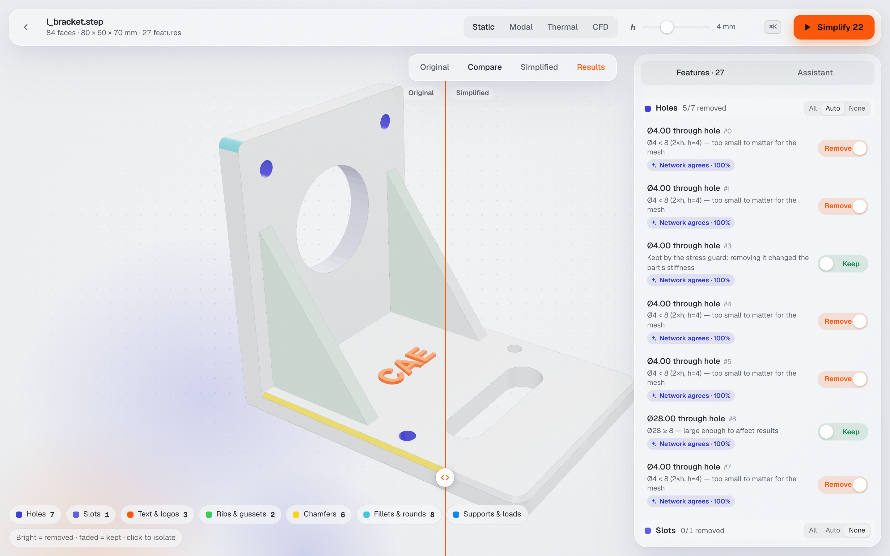
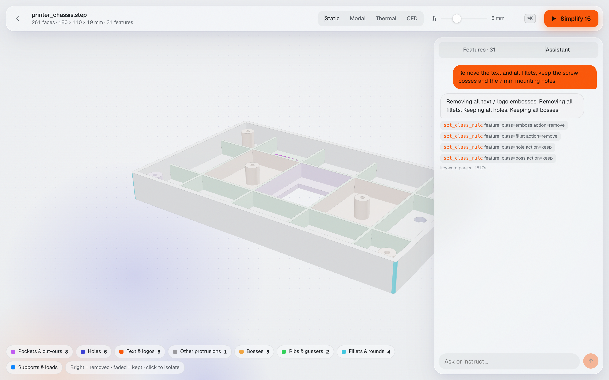
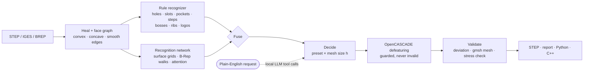
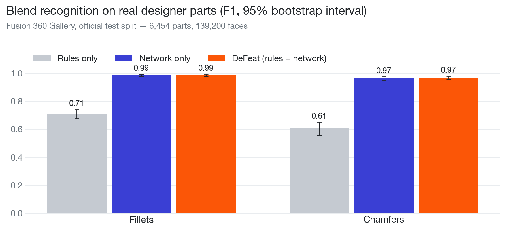

<div align="center">

# DeFeat

### Simulation-ready CAD, in a sentence.

DeFeat takes a mold-part STEP file and finds its holes, slots, pockets, bosses, ribs, logos, fillets and chamfers.<br>
It decides what matters for your analysis and removes the rest. Then it **checks the result**: both models are meshed and the same four load cases are solved on each.


<picture>
  <source media="(prefers-color-scheme: dark)" srcset="docs/images/welcome-dark.png">
  
</picture>

<sub>The hero is a live dot-matrix render of a real part. Highlighted dots are the features DeFeat will remove; they dissolve away to show the simulation-ready result.</sub>

</div>

## What you get

<table>
<tr>
<td width="50%"><b>Before / after, side by side</b><br><sub>Drag the wipe line to compare the original and simplified model.</sub><br><br>
<picture><source media="(prefers-color-scheme: dark)" srcset="docs/images/compare-dark.png"></picture></td>
<td width="50%"><b>Checked, not assumed</b><br><sub>Mesh elements, geometric deviation and a four-case static stress check on both models, plus a STEP, a report and code to download.</sub><br><br>
<picture><source media="(prefers-color-scheme: dark)" srcset="docs/images/results-dark.png"></picture></td>
</tr>
<tr>
<td width="50%"><b>Every feature, explained</b><br><sub>Colour-coded by class, with a plain-English keep/remove reason and the network's second opinion. Click a chip to isolate a class, or press <kbd>⌘K</kbd> for the command palette.</sub><br><br>
<picture><source media="(prefers-color-scheme: dark)" srcset="docs/images/features-dark.png"></picture></td>
<td width="50%"><b>Talk to your part</b><br><sub>A local open-source LLM turns plain English into exact tool calls. No CAD skills needed, and nothing leaves the machine.</sub><br><br>
</td>
</tr>
</table>

**Outputs:**
- a simplified **STEP**
- an HTML/PDF **report**
- a standalone **Python** script and **C++** program that reproduce the result from the original file. The Python one is round-trip verified.
- an optional CFD **fluid domain**

## Videos

- **Intro** (95 s): `docs/videos/defeat-intro.mp4`
- **Walkthrough** (175 s): `docs/videos/defeat-walkthrough.mp4`

Both are built entirely from code and open models. The narration is [Kokoro](https://github.com/thewh1teagle/kokoro-onnx) (open weights, runs offline). The picture is [Remotion](https://www.remotion.dev), with real 3D parts rendered in three.js. The original 96 BPM score and every sound effect are synthesised in Python. The intro's showcase parts are modelled for the film in `video/parts.py`: a mold cavity plate, gearbox cover, flanged hub, heat sink and robot-arm link, alongside the two samples. `video/export_mesh.py` runs DeFeat on each and exports the original and simplified meshes, so every orange face that lifts away on screen is one DeFeat actually removes. The script and its timing live in `video/plan.json`. `video/score.py` places each line on the bar grid, ducks the music under the voice and writes the timing to `video/src/cues.ts`, so the voice, cuts and captions land on the same frame. To rebuild them:
```bash
cd video
python3.11 -m venv .tts && .tts/bin/pip install kokoro-onnx soundfile   # plus the two model files in video/tts_models/
../.venv/bin/python parts.py && ../.venv/bin/python export_mesh.py       # showcase parts + meshes
.tts/bin/python voice.py && ../.venv/bin/python score.py                 # narration, then score + mix
../.venv/bin/python capture.py                                           # app captures (app running)
npm install && npm run render:intro && npm run render:guide
```

## How it works



| Stage | Module | What it does |
|---|---|---|
| Ingest | `occ.py` | Reads STEP/IGES/BREP, heals the shape with ShapeFix, and indexes faces stably |
| Face graph | `graph.py` | Builds a face-adjacency graph with exact convex/concave/smooth edges (material-side rule on the edge's 2D curve) |
| Rules | `recognize.py` | Inner-loop flood fill finds holes, slots, pockets, bosses and embosses. Concave-edge regions find steps and open channels. Also detects thin-wall ribs and gussets, blend chains and chamfers |
| Network | `net.py`, `brepfeat.py` | Two models, averaged. Each face is described by a 10×10 grid of points and normals sampled on its surface (the UV-Net idea) and each edge by a sampled curve. Winged-edge walks around every coedge pass information through the B-Rep topology (the BRepNet idea). Two layers of face self-attention let distant faces of the same part inform each other, and part-wide context and the rule recognizer's guesses are inputs too. One head predicts DeFeat's classes, a second predicts the Fusion 360 Gallery's eight modelling labels. 2.8–2.9 million parameters per model; the second model drops the surface grids, so the pair disagree in useful ways |
| Fuse | `recognize.py` | The network confirms or vetoes rule fillets and chamfers, adds the ones the rules miss, and fills in steps and cut-outs the rules can't see. Its cut-history head marks small cut-outs only: a large design cut is part of the shape, not a feature to remove. Every threshold was tuned on validation parts |
| Decide | `decide.py` | Presets for static, modal, thermal and CFD. Thresholds are multiples of the target mesh size *h*, because a feature only hurts the mesh when it's small relative to the elements. When the stress check will run, it judges what can go, so nothing is held back up front. Without it, a volume budget keeps the total change small |
| Execute | `execute.py` | `BRepAlgoAPI_Defeaturing` (run in parallel) inside a killable worker process, so hangs and native crashes are contained. It tries a single pass first, then goes feature by feature, then retries a refused blend with its tangent neighbours. Features are tracked exactly through each removal using the kernel's own history. A removal that adds or takes away more material than its feature could account for is rejected |
| Validate | `validate.py`, `fea.py`, `sensitivity.py` | Surface deviation, deterministic gmsh meshing of both models at the same *h*, a linear static solve on both meshes (scikit-fem, quadratic tetrahedra, four load cases), and a **stress guard**. When a load case moves more than 5% (for the static preset: deflection or peak stress), it prices each removed feature by the stress field around it, puts back the costliest first, and bisects to keep as many removals as stay within tolerance |
| Export | `codegen.py` | Python (OCP) and C++ (OCCT) programs that locate faces by geometric signature |
| Assistant | `agent.py`, `server.py` | Ollama tool calling (`qwen3.5:4b`) with a keyword fallback that needs no model, plus sandboxed text-to-CAD (CadQuery) with a repair loop |

## Benchmarks

Every number below is measured on **held-out test data that was never used for training or tuning**, unless a line says otherwise. Each test set was scored once, after every choice had been made on validation parts. The raw results are in [`bench/results/`](bench/results/), and every benchmark can be re-run (see *Reproduce*). Hardware: a CPU-only laptop. "Precision" means: of the faces DeFeat flags, how many are right. "Recall" means: of the true feature faces, how many DeFeat finds. Intervals are 95%: Wilson score intervals for rates, and a 2,000-sample bootstrap that resamples whole parts (faces of one part aren't independent) for everything else.

### Recognition

<picture>
  <source media="(prefers-color-scheme: dark)" srcset="docs/images/chart-fusion-dark.png">
  
</picture>

| Fusion 360 Gallery: the whole test split, 6,454 real designer parts (139,200 faces) | Rules only (P / R / F1) | Network only | **Shipped: rules + network** |
|---|---|---|---|
| Fillets | 0.60 / 0.88 / 0.71 | 0.98 / 0.99 / 0.99 | **0.985 / 0.991 / 0.988** (0.979–0.994) |
| Chamfers | 0.71 / 0.53 / 0.61 | 0.96 / 0.97 / 0.97 | **0.993 / 0.947 / 0.969** (0.957–0.979) |

- The shipped column is the app's own code path (`defeat.recognize.refine_with_net`), not a separate benchmark copy. It takes 1.8 s per part, including reading the STEP file.
- The previous release scored fillet F1 0.87 and chamfer F1 0.82 on half of these parts. The new network cuts the error about tenfold on fillets and sixfold on chamfers.
- Fusion's "cut" label records how a face was modelled, not whether it is a small feature. The network's own eight-label head gets cut faces right at F1 0.92. The shipped path scores 0.69 against that label on purpose: it only marks cut-outs that are small enough to remove.

**Eight-label segmentation**, the measure used in published work on this dataset. These are the network's own predictions on 6,449 test parts:

| Model | Accuracy | Mean IoU |
|---|---|---|
| **DeFeat, two-model ensemble** | **94.95%** (94.39–95.46) | **81.2%** (79.4–83.8) |
| DeFeat, the same model with only B-Rep walks | 94.51% (93.88–95.06) | 80.3% (78.4–82.3) |
| BRepNet, published | 92.52% | 77.10% |
| BRT (B-rep transformer), published | 90.47% | 70.16% |
| UV-Net, published | 89.03% | 66.47% |

- The published numbers use version s2.0.0 of the dataset. DeFeat is scored on the s2.0.1 extended-STEP release of the same official split, so the comparison is close but not exact.
- The walks-only row is DeFeat's own BRepNet-style model trained the same way, and it already beats the published BRepNet. So most of the gain probably comes from training data and the dataset version rather than the architecture. The ensemble adds a further gain inside overlapping intervals.
- Rotating every test part at random gives the same score (94.98%, 81.3%), so the network doesn't depend on how a part is oriented.
- IoU by label: Fillet 0.98, ExtrudeSide 0.93, Chamfer 0.93, ExtrudeEnd 0.88, RevolveSide 0.87, CutSide 0.85, CutEnd 0.74, RevolveEnd 0.32. RevolveEnd is rare and is usually indistinguishable from an extrude end.

<picture>
  <source media="(prefers-color-scheme: dark)" srcset="docs/images/chart-mfcad-dark.png">
  
</picture>

| MFCAD: all 3,122 test parts (70,850 faces) | Rules only (P / R / F1) | Network only | **Shipped: rules + network** |
|---|---|---|---|
| Feature vs. body | 0.98 / 0.91 / 0.95 | 1.00 / 1.00 / 1.00 | **0.98 / 0.94 / 0.96** |
| Cut-outs (slots, passages, pockets) | 0.84 / 0.82 / 0.83 | 0.96 / 1.00 / 0.98 | **1.00 / 0.98 / 0.99** |
| Steps / shoulders | 0.41 / 0.33 / 0.37 | 0.93 / 1.00 / 0.96 | **1.00 / 0.93 / 0.96** |

- MFCAD's parts all come from one generator, so train and test look alike, and the network alone is near-perfect. Fusion 360 is the harder, more honest test.
- Steps went from F1 0.89 to 0.96 against the previous release, and cut-outs from 0.98 to 0.99.
- Feature vs. body dropped from 0.99 to 0.96 because of MFCAD's "chamfer" class. It is a large bevel cut, not an edge chamfer, and the shipped path keeps 2,383 of its 2,622 faces as body: a bevel that size is part of the shape. It isn't retuned, because that would mean tuning on the test set.

### The full pipeline on real parts

<picture>
  <source media="(prefers-color-scheme: dark)" srcset="docs/images/chart-robust-dark.png">
  
</picture>

The run uses 500 Fusion 360 test parts that none of the other benchmarks or tuning runs touched, with a 40-minute limit per part.

| Full pipeline on 500 fresh real parts | Result |
|---|---|
| Parts completed | **500 / 500** (99.2–100%) |
| Output is a valid solid | **100%** (99.2–100%) |
| Targeted features the kernel removed | **86.4%** (74.5–95.5%). The rest are kept and reported, never broken |
| Within 5% on all four load cases, after the guard (204 parts) | **100%** (98.2–100%). This is what the guard enforces; see below |
| Median worst load-case change (same 204 parts) | **0.70%** (0.47–1.08%), 90th percentile 3.7% |
| Median change in deflection / peak stress | 0.26% / 0.27%, 90th percentile 2.3% / 2.0% |
| Faces removed / volume change | median 11% / 0.14% |
| Mesh elements removed (207 parts) | median 7.5%, 90th percentile 63% |
| Time per part | median 1.0 s, 90th percentile 128 s (this includes meshing and solving both models) |

220 of the 500 parts had something to remove; the other 280 have no features worth removing and are returned as they were. Where every targeted feature went:

| 1,478 targeted features | Count |
|---|---|
| Removed, and still gone in the final part | **762** |
| Put back by the stress guard | 373 |
| Refused by the kernel, kept and reported | 201 |
| Kept because no stress comparison came back, so only the volume-budget removals were allowed | 142 |

- **Parts without a stress comparison:** 16 of the 220. Four couldn't be meshed, two were too heavy for this laptop, and on two the simplified part couldn't carry the original's supports. Eight of the 16 come out unchanged. The other eight keep only small volume-budget removals, and the app tells the user plainly that this part has no stress check.
- **The median mesh reduction is modest because most real parts have little to remove.** On parts with real features the cut is large: the 90th percentile is 63%, and on the worked examples below it is about half.

**The stress check:** the last 5% of the part's volume at one end of its long axis is clamped, and the same share at the other end carries the load: bending about both axes, tension and torsion. Both regions are fixed on the original and reused unchanged for the simplified model, so removing something right at an end can't change the test. You can choose your own supports and loads in the app instead. The solver matches CalculiX given the same meshes, supports and loads (40 parts tried, one too large and one timed out; median difference 0.0000003%, largest 0.000006%), and beam theory on a cantilever to within 0.3%.

**What the stress guard prevented:**
- DeFeat now removes everything the physics might allow and lets the check decide. The previous release capped removal up front with a volume budget. So the guard works harder: before it, 52.9% (46.1–59.7%) of the 204 parts were within 5% on every load case.
- It triggered on 96 parts. On 55, putting some features back was enough (a median of 2). On 41 every removal was undone, so those parts come out unchanged.
- The 41 full undos are mostly tiny parts where the only "feature" is structural. On 22 of them a single feature was targeted, and removing it changed the result by about 25% on median, up to 774%.
- After the guard all 204 parts are within 5%. That is what the guard enforces, not an independent result; the mesh check below is the independent one.

**Does the answer depend on the mesh?** Measured on validation parts, comparing the working mesh with one twice as fine, before any guard. Only parts small enough for the finer mesh to fit the solver can be checked: 55 of the parts with something removed.

| Mesh check | Result |
|---|---|
| Same unchanged part at *h* and 0.9 *h* (the check's own noise, 68 parts) | median 0.85%, 90th percentile 3.8% |
| Change from defeaturing, working mesh vs. finer mesh | median difference 0.78 points, 90th percentile 3.4 |
| Both meshes agree on the within-5% verdict | **92.7%** (82.7–97.1%), 51 of 55 |
| Passed on the working mesh, failed on the finer one | **3 of 42** (at 5.1%, 6.0% and 9.8%) |

So a pass is strong evidence, not a guarantee. Treat anything close to 5% as a reason to look.

**Worked examples** (bundled samples, static preset):

| Part | Removed | Faces | Tetrahedra | Worst load case | Stress guard |
|---|---|---|---|---|---|
| L-bracket | 22 / 27 | 84 → 32 | **−50%** | 2.8% | saw 5.0%, put 1 feature back |
| Printer chassis | 21 / 31 | 261 → 105 | **−54%** | 4.2% (4.4% on the finer mesh) | not needed |

The previous release removed 16 and 11 features here, for −26% and −29%. On the L-bracket the thermal preset removes 23 features (−55%) and CFD removes 21 (−45%).

### Assistant

| Commands, tool calls exactly right | Local LLM (`qwen3.5:4b`, offline) | Keyword fallback |
|---|---|---|
| **80 held-out commands** | **93.8%** (86.2–97.3%), F1 0.97 | 80.0% (70.0–87.3%), F1 0.90 |
| 96 development commands (tuned on these) | 99.0% | 100% |

| Text-to-CAD: 50 held-out part descriptions (`qwen3.5:4b`) | Result |
|---|---|
| Produces a valid solid | **96%** (86.5–98.9%), 44% on the first try (the repair loop fixes the rest) |
| Within 10% of the requested dimensions | **82%** (69.2–90.2%) |
| Median time | 62 s (commands: 26 s) |

- The held-out commands and descriptions were written before the new prompts, examples and repair loop were run on them. The previous release scored 87.5% and 66.7% on its commands, and 70% valid / 50% on dimensions for text-to-CAD.
- The model's typical miss is reading "fill the pockets" as keep, when filling a pocket removes it.

**Training data:** each network learns from 43,698 parts:
- **34,908 Fusion 360 Gallery training parts** (731,417 faces, all eight labels), the official train split minus 1,499 parts held back for validation
- **6,000 MFCAD training parts**
- **2,790 procedurally generated mold parts** with exact labels for logos, bosses, ribs and pockets

The rule recognizer isn't trained; it reads exact B-Rep geometry.

## Install

You need **Python 3.10–3.12**. Two things are optional: **Ollama** for the AI assistant, and **Node 18+** (only if you change the web UI, since a built UI is included).

**Windows (PowerShell)**
```powershell
powershell -ExecutionPolicy Bypass -File setup.ps1
.\run.bat
```

**macOS / Linux**
```bash
./setup.sh
./run.sh
```
Linux desktops may also need the OpenGL runtime: `sudo apt install libgl1 libglu1-mesa libxrender1 libxcursor1 libxft2 libxinerama1`.

The app opens at **http://localhost:8000**. For the assistant, install [Ollama](https://ollama.com) and run `ollama pull qwen3.5:4b`. Without it, a keyword mode handles the common commands, less reliably (see *Benchmarks*).

**Batch mode** (whole folders, no UI):
```bash
python -m defeat.cli parts/*.step --preset static --h 3 --out out/
```

**FreeCAD:** run DeFeat from inside FreeCAD with the macro in [`freecad/`](freecad/). Select a part, pick the analysis, and the simplified copy appears next to the original.

**NX:** DeFeat can't read `.prt` files directly, because no open-source reader exists. [`nx/export_step.py`](nx/export_step.py) is an NX journal that exports them to STEP. It hasn't been run in a real NX install yet, so treat it as a starting point.

**Tests:** `python -m pytest -q tests`. CI runs them on Windows, Linux and macOS.

## Reproduce the benchmarks
```bash
# datasets go in ~/defeat-data (or set DEFEAT_DATA):
#   git clone https://github.com/hducg/MFCAD ~/defeat-data/mfcad
#   Fusion 360 Gallery s2.0.1_extended_step.7z -> ~/defeat-data/fusion_ext/
python -m bench.build_brep --workers 8                    # training tensors: Fusion train split, MFCAD, generated parts
python -m bench.train_net --name m1 --epochs 12 --attn 2 --seed 1
python -m bench.train_net --name m2 --epochs 12 --attn 2 --seed 2 --no-uv
cp models/net_m1.pt models/recognizer_1.pt && cp models/net_m2.pt models/recognizer_2.pt
python -m bench.tune_net                                  # rules + network thresholds, on the validation parts
python -m bench.segment --split test                      # eight-label segmentation
python -m bench.fusion --n 99999                          # the whole Fusion test split
python -m bench.mfcad --n 99999                           # every MFCAD test part
python -m bench.robust --n 500 --skip 1500 --mesh 500 --workers 5 --timeout 2400
python -m bench.convergence --n 400 --workers 8           # does the stress check depend on the mesh? (validation parts)
python -m bench.solver_check --n 40                       # stress solver vs CalculiX and beam theory
python -m bench.assistant
python docs/make_charts.py          # regenerate the charts above
python docs/capture.py              # regenerate the screenshots (app must be running)
```

## Limits
- **The stress check is a comparison tool, not a replacement for the real CAE run.** It's linear and isotropic, and the automatic supports and loads are a stand-in for yours. Choose your own in the app when you know them.
- **A pass isn't a guarantee.** 3 of 42 checked parts that passed on the working mesh failed on a finer one, and that check only reaches parts small enough for the finer mesh.
- **Some parts get no stress check.** 16 of 220 on the real-part run, because they couldn't be meshed or were too heavy for a 16 GB laptop. They keep only small removals, and the app says so.
- **Recognition isn't perfect.** Fillets and chamfers are near 0.97–0.99 F1, but no model here is at 1.0. Rare labels such as revolve ends are weak (IoU 0.32).
- **The segmentation comparison isn't exact.** The published scores use an earlier version of the dataset.
- **NX files need exporting to STEP first.** There's no open-source `.prt` reader, and the NX journal hasn't run in a real NX install.
- **FreeCAD macro:** re-tested on this release in headless FreeCAD. The full GUI run dates from an earlier release; see [`freecad/README.md`](freecad/README.md).
- **The assistant can misread a command.** The local LLM gets about 15 in 16 held-out commands exactly right, and the keyword fallback 4 in 5. Text-to-CAD misses the requested dimensions on about 1 part in 5, so check what it builds.

**Tried and dropped:** rebuilding parts from cells instead of removing faces (more failures, not fewer), a fixed stress hot-spot rule in place of the guard's pricing (it put back the wrong features), training without random rotations (worse on rotated parts), and retrying refused removals with a fuzzy tolerance (0 of 83 retries succeeded).
