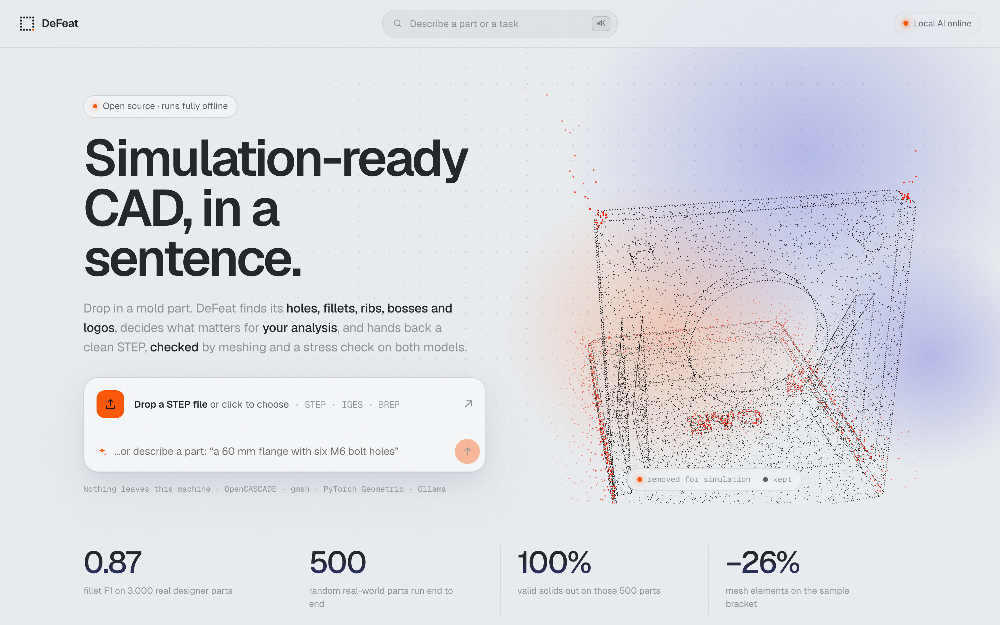
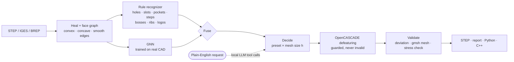

<div align="center">

# DeFeat

### Simulation-ready CAD, in a sentence.

DeFeat takes a mold-part STEP file and finds its holes, slots, pockets, bosses, ribs, logos, fillets and chamfers.<br>
It decides what matters for your analysis and removes the rest. Then it **checks the result**: both models are meshed and the same four load cases are solved on each.


<picture>
  <source media="(prefers-color-scheme: dark)" srcset="docs/images/welcome-dark.png">
  
</picture>

<sub>The hero is a live dot-matrix render of a real part. Highlighted dots are the features DeFeat will remove; they dissolve away to show the simulation-ready result.</sub>

</div>

## What you get

<table>
<tr>
<td width="50%"><b>Before / after, side by side</b><br><sub>Drag the wipe line to compare the original and simplified model.</sub><br><br>
<picture><source media="(prefers-color-scheme: dark)" srcset="docs/images/compare-dark.png"></picture></td>
<td width="50%"><b>Checked, not assumed</b><br><sub>Mesh elements, geometric deviation and a four-case static stress check on both models, plus a STEP, a report and code to download.</sub><br><br>
<picture><source media="(prefers-color-scheme: dark)" srcset="docs/images/results-dark.png"></picture></td>
</tr>
<tr>
<td width="50%"><b>Every feature, explained</b><br><sub>Colour-coded by class, with a plain-English keep/remove reason and a GNN second opinion. Click a chip to isolate a class, or press <kbd>⌘K</kbd> for the command palette.</sub><br><br>
<picture><source media="(prefers-color-scheme: dark)" srcset="docs/images/features-dark.png"></picture></td>
<td width="50%"><b>Talk to your part</b><br><sub>A local open-source LLM turns plain English into exact tool calls. No CAD skills needed, and nothing leaves the machine.</sub><br><br>
</td>
</tr>
</table>

**Outputs:**
- a simplified **STEP**
- an HTML/PDF **report**
- a standalone **Python** script and **C++** program that reproduce the result from the original file. The Python one is round-trip verified.
- an optional CFD **fluid domain**

## Videos

- **Intro** (95 s): `docs/videos/defeat-intro.mp4`
- **Walkthrough** (175 s): `docs/videos/defeat-walkthrough.mp4`

Both are built entirely from code and open models. The narration is [Kokoro](https://github.com/thewh1teagle/kokoro-onnx) (open weights, runs offline). The picture is [Remotion](https://www.remotion.dev), with real 3D parts rendered in three.js. The original 96 BPM score and every sound effect are synthesised in Python. The intro's showcase parts are modelled for the film in `video/parts.py`: a mold cavity plate, gearbox cover, flanged hub, heat sink and robot-arm link, alongside the two samples. `video/export_mesh.py` runs DeFeat on each and exports the original and simplified meshes, so every orange face that lifts away on screen is one DeFeat actually removes. The script and its timing live in `video/plan.json`. `video/score.py` places each line on the bar grid, ducks the music under the voice and writes the timing to `video/src/cues.ts`, so the voice, cuts and captions land on the same frame. To rebuild them:
```bash
cd video
python3.11 -m venv .tts && .tts/bin/pip install kokoro-onnx soundfile   # plus the two model files in video/tts_models/
../.venv/bin/python parts.py && ../.venv/bin/python export_mesh.py       # showcase parts + meshes
.tts/bin/python voice.py && ../.venv/bin/python score.py                 # narration, then score + mix
../.venv/bin/python capture.py                                           # app captures (app running)
npm install && npm run render:intro && npm run render:guide
```

## How it works



| Stage | Module | What it does |
|---|---|---|
| Ingest | `occ.py` | Reads STEP/IGES/BREP, heals the shape with ShapeFix, and indexes faces stably |
| Face graph | `graph.py` | Builds a face-adjacency graph with exact convex/concave/smooth edges (material-side rule on the edge's 2D curve) |
| Rules | `recognize.py` | Inner-loop flood fill finds holes, slots, pockets, bosses and embosses. Concave-edge regions find steps and open channels. Also detects thin-wall ribs and gussets, blend chains and chamfers |
| GNN | `gnn.py`, `datagen.py` | GINE network on pose-invariant face/edge features, trained on generated mold parts plus real labelled CAD (MFCAD, Fusion 360 Gallery). It vetoes or adds fillets/chamfers on top of the rules, fills in the steps and cut-outs the rules miss, and a very confident call can take a face back from a rule feature, with all thresholds tuned on validation parts |
| Decide | `decide.py` | Presets for static, modal, thermal and CFD. Thresholds are multiples of the target mesh size *h*, because a feature only hurts the mesh when it's small relative to the elements. Each preset also has a volume budget, so removal stops before it adds up to a real change in material |
| Execute | `execute.py` | `BRepAlgoAPI_Defeaturing` runs in a killable worker process, so hangs and native crashes are contained. It tries a single pass first, then goes feature by feature. Features are tracked exactly through each removal using the kernel's own history. A refused blend is retried together with its tangent neighbours, then with a fuzzy tolerance. A removal that adds or takes away more material than its feature could account for is rejected |
| Validate | `validate.py`, `fea.py` | Surface deviation, deterministic gmsh meshing of both models at the same *h*, a linear static solve on both meshes (scikit-fem, quadratic tetrahedra, four load cases), and a **stress guard** that puts features back when any load case moves more than 5% |
| Export | `codegen.py` | Python (OCP) and C++ (OCCT) programs that locate faces by geometric signature |
| Assistant | `agent.py`, `server.py` | Ollama tool calling (`qwen3.5:4b`) with a keyword fallback that needs no model, plus sandboxed text-to-CAD (CadQuery) |

## Benchmarks

Every number below is measured on **held-out test data that was never used for training or tuning**, unless a line says otherwise. The raw results are in [`bench/results/`](bench/results/), and every benchmark can be re-run (see *Reproduce*). Hardware: a CPU-only laptop. "Precision" means: of the faces DeFeat flags, how many are right. "Recall" means: of the true feature faces, how many DeFeat finds.

<picture>
  <source media="(prefers-color-scheme: dark)" srcset="docs/images/chart-fusion-dark.png">
  
</picture>

| Fusion 360 Gallery: 3,000 real designer parts (63,888 faces) | Rules only (P / R / F1) | GNN only | **Shipped: rules + GNN** |
|---|---|---|---|
| Fillets | 0.56 / 0.88 / 0.69 | 0.81 / 0.96 / 0.88 | **0.85 / 0.88 / 0.87** |
| Chamfers | 0.65 / 0.52 / 0.58 | 0.75 / 0.87 / 0.81 | **0.78 / 0.86 / 0.82** |
| F1, 95% interval (shipped) | | | fillets 0.84–0.89 · chamfers 0.76–0.87 |

| Shipped F1 on each half of those parts | Fillets | Chamfers |
|---|---|---|
| Fresh 1,500 parts, never looked at before this run | 0.87 (0.84–0.90) | 0.87 (0.82–0.91) |
| The 1,500 parts the previous release reported on | 0.87 (0.83–0.89) | 0.77 (0.68–0.85) |

- The 95% intervals come from a 2,000-sample bootstrap that resamples whole parts, since faces of one part aren't independent.
- The shipped column is the app's own code path (`defeat.recognize.refine_with_gnn`), not a separate benchmark copy.
- Chamfers are few (about 1,400 faces here) and vary a lot between slices. On the same 1,500 parts as the previous release, chamfer F1 is 0.77 against 0.78 then, so read the interval, not the single number.
- The GNN alone finds more fillets, but flags more faces wrongly. The shipped mix favours precision, because a face removed by mistake costs more than one left in.
- Some counted errors are label conventions rather than mistakes. Of 214 wrongly flagged fillet faces on the validation parts, 130 were tangent to their neighbours along both long sides: they look like fillets, but were modelled as part of an extrusion.

<picture>
  <source media="(prefers-color-scheme: dark)" srcset="docs/images/chart-mfcad-dark.png">
  
</picture>

| MFCAD: all 3,122 test parts (70,850 faces) | Rules only (P / R / F1) | GNN only | **Shipped: rules + GNN** |
|---|---|---|---|
| Feature vs. body | 0.98 / 0.91 / 0.95 | 1.00 / 1.00 / 1.00 | **0.98 / 0.99 / 0.99** |
| Cut-outs (slots, passages, pockets) | 0.84 / 0.82 / 0.83 | 0.98 / 1.00 / 0.99 | **0.99 / 0.98 / 0.98** |
| Steps / shoulders | 0.41 / 0.33 / 0.37 | 0.88 / 1.00 / 0.93 | **0.86 / 0.93 / 0.89** |

- On MFCAD the GNN is near-perfect because MFCAD's parts all come from one generator, so train and test look alike. Fusion 360 is the harder, more honest test.
- MFCAD's "chamfer" class is a large bevel cut, not an edge chamfer, so it isn't scored as a chamfer.
- The rules+GNN thresholds were tuned on 400 separate validation parts from the Fusion train split. The GNN never trains on them, and nothing is tuned on the test split.

<picture>
  <source media="(prefers-color-scheme: dark)" srcset="docs/images/chart-robust-dark.png">
  
</picture>

| Full pipeline on 500 fresh real parts | Result |
|---|---|
| Parts completed | **500 / 500** (95% interval 99.2–100%) |
| Output is a valid solid | **100%** (99.2–100%) |
| Targeted features the kernel removed | **89.2%** (81.4–94.7%). The rest are kept and reported, never broken |
| Targeted features still gone after the stress guard | 75.5% (642 of 850) |
| Time per part | median 0.53 s, 90th percentile 125 s (this includes meshing and solving both models) |
| Faces removed / volume change | median 13% / 0.14% |
| Mesh elements removed (151 parts) | median 9%, 90th percentile 75%. About a third of these parts don't shrink, most of them because nothing ended up removed |
| Within 5% on all four load cases, **before** the guard (150 parts) | 82.0% (75.1–87.3%) |
| Within 5% on all four load cases, **after** the guard (150 parts) | 100% (97.5–100%). This is what the guard enforces, not an independent result; see below |
| Median worst load-case change (same 150 parts) | 0.95% (0.72–1.36%), 90th percentile 3.3% |

- 154 of the 500 parts had something to remove. The other 346 are left as they were and have nothing to compare. 150 of the 154 gave a stress result on both models. The other 4 still get a valid solid, just no stress check.
- Intervals are 95%: Wilson score intervals for rates, a part-level bootstrap for medians.

**The stress check:** the last 5% of the part's volume at one end of its long axis is clamped, and the same share at the other end carries the load: bending about both axes, tension and torsion. Both regions are fixed on the original and reused unchanged for the simplified model, so removing something right at an end can't change the test. The result is the largest change across the four cases.

**Stress guard:**
- **What it does:** when any load case moves more than 5%, DeFeat puts the largest removed features back in batches and re-checks. If only the full part stays within tolerance, it undoes every removal and says so.
- **Measured:** it triggered on 27 of the 150 parts. On 16 of them putting some features back was enough. On the other 11 every removal was undone, so those parts come out unchanged. 116 features were put back in total.
- **What the 100% means:** 32 of the 150 parts ended with nothing removed (those 11, plus 21 where the kernel or the material check kept everything), so they pass trivially. The fairer figure is the 118 parts that really changed: all 118 are within 5%, with a largest change of 4.98%.

**Does the answer depend on the mesh?** Measured on validation parts, comparing the working mesh with one twice as fine, before any guard. Only parts small enough for the finer mesh to fit the solver can be checked: 53 of the 144 with something removed.

| Mesh check | Result |
|---|---|
| Same unchanged part at *h* and 0.9 *h* (the check's own noise, 65 parts) | median 0.79%, 90th percentile 4.1% |
| Change from defeaturing, working mesh vs. finer mesh | median difference 0.78 points, 90th percentile 5.0 |
| Both meshes agree on the within-5% verdict | **92.5%** (82.1–97.0%), 49 of 53 |
| Passed on the working mesh, failed on the finer one | **2 of 44** (at 6.0% and 9.8%) |

So a pass is strong evidence, not a guarantee. Treat anything close to 5% as a reason to look.

| Assistant | Local LLM (`qwen3.5:4b`, offline) | Keyword fallback |
|---|---|---|
| 72 held-out commands (tool calls exactly right) | **87.5%** (77.9–93.3%), F1 0.89 | 66.7% (55.2–76.5%), F1 0.82 |
| 24 development commands | 91.7% (74.2–97.7%) | 95.8% (tuned on these) |

| Text-to-CAD: 50 part descriptions (`qwen3.5:4b`) | Result |
|---|---|
| Produces a valid solid | 70% (56.3–80.9%), 50% on the first try |
| Within 10% of the requested dimensions | 50% (36.6–63.4%) |
| Median time | 34 s (commands: 25 s) |

Nothing was tuned on the held-out commands or the 50 descriptions. These are lower than the 12-item figures in the previous release because the larger sets are harder and the intervals are real.

**Worked examples** (bundled samples):

| Part | Removed | Faces | Tetrahedra | Volume | Deflection Δ | Peak stress Δ (p99) | Worst load case |
|---|---|---|---|---|---|---|---|
| L-bracket | 16 / 25 | 84 → 36 | **−26%** | +0.08% | −0.9% | −2.9% | 2.3% |
| Printer chassis | 11 / 31 | 261 → 168 | **−29%** | +0.02% | +0.4% | +1.1% | 4.0% |

On the chassis the guard saw 6.6% on tension and put 10 of 21 features back. The previous release showed bigger mesh reductions on these parts (−55% and −42%) but checked only one load case. Removing less is the price of staying within tolerance in all four.

**Training data:** the GNN (175k parameters) learns from three sources:
- **300 procedurally generated mold parts**
- **3,000 MFCAD training parts**
- **36,007 Fusion 360 Gallery training parts**: the whole official train split except 400 parts held back for validation (fillet/chamfer labels, with a partial-label loss for the other faces)

The rule recognizer isn't trained; it reads exact B-Rep geometry.

## Install

You need **Python 3.10–3.12**. Two things are optional: **Ollama** for the AI assistant, and **Node 18+** (only if you change the web UI, since a built UI is included).

**Windows (PowerShell)**
```powershell
powershell -ExecutionPolicy Bypass -File setup.ps1
.\run.bat
```

**macOS / Linux**
```bash
./setup.sh
./run.sh
```
Linux desktops may also need the OpenGL runtime: `sudo apt install libgl1 libglu1-mesa libxrender1 libxcursor1 libxft2 libxinerama1`.

The app opens at **http://localhost:8000**. For the assistant, install [Ollama](https://ollama.com) and run `ollama pull qwen3.5:4b`. Without it, a keyword mode handles the common commands, less reliably (see *Benchmarks*).

**Batch mode** (whole folders, no UI):
```bash
python -m defeat.cli parts/*.step --preset static --h 3 --out out/
```

**FreeCAD:** run DeFeat from inside FreeCAD with the macro in [`freecad/`](freecad/). Select a part, pick the analysis, and the simplified copy appears next to the original.

**NX:** DeFeat can't read `.prt` files directly, because no open-source reader exists. [`nx/export_step.py`](nx/export_step.py) is an NX journal that exports them to STEP. It hasn't been run in a real NX install yet, so treat it as a starting point.

**Tests:** `python -m pytest -q tests`. CI runs them on Windows, Linux and macOS.

## Reproduce the benchmarks
```bash
# datasets go in ~/defeat-data (or set DEFEAT_DATA):
#   git clone https://github.com/hducg/MFCAD ~/defeat-data/mfcad
#   Fusion 360 Gallery s2.0.1_extended_step.7z -> ~/defeat-data/fusion_ext/
python -m bench.build_synth --n 300              # generated training graphs
python -m bench.build_real                       # training graphs (train split only, validation parts skipped)
python -c "from defeat.gnn import train; train('models/dataset.pkl', epochs=40, batch=32, hidden=128, extra_paths=['models/dataset_real.pkl'])"
python -m bench.tune_fusion --n 400              # rules + GNN thresholds, on the 400 validation parts
python -m bench.mfcad --n 99999                  # every MFCAD test part
python -m bench.fusion --n 3000
python -m bench.robust --n 500 --skip 1000 --mesh 500 --timeout 2400
python -m bench.convergence --n 400 --workers 5  # does the stress check depend on the mesh? (validation parts)
python -m bench.assistant
python docs/make_charts.py          # regenerate the charts above
python docs/capture.py              # regenerate the screenshots (app must be running)
```

## Limits
- **No external baseline.** These results show how the parts of DeFeat compare with each other. Nothing here compares it with another defeaturing tool or a published recognizer on the same parts.
- **The stress check is a comparison tool, not a replacement for the real CAE run.** It's linear and isotropic, with automatic supports and loads rather than yours, and the clamped and loaded end regions themselves aren't stress-tested.
- **A pass isn't a guarantee.** 2 of 44 checked parts that passed on the working mesh failed on a finer one, and that check only reaches smaller parts.
- **Mesh reduction is modest on many parts.** The median is 9%, and on the worked examples it's about a quarter. The safer defaults remove less than the previous release did, and on 11 of 150 parts the guard undoes everything. Review anything it flags.
- **Fillet false alarms and chamfers.** Rounded sketch profiles and freeform spline walls can look like fillets. Chamfer scores vary a lot between slices (0.77 to 0.87).
- **Steps and cut-outs on real parts.** They're strong on MFCAD (0.89 and 0.98), but MFCAD's parts are all generated. On Fusion 360's rougher cut-side labels, shipped F1 is only 0.51 (rules alone: 0.55), so real-part performance is unproven.
- **NX files need exporting to STEP first.** There's no open-source `.prt` reader, and the NX journal is untested.
- **FreeCAD macro:** re-tested on this release in headless FreeCAD. The full GUI run dates from the previous release; see [`freecad/README.md`](freecad/README.md).
- **The assistant isn't perfect.** The local LLM gets about 7 in 8 commands exactly right. The keyword fallback gets 2 in 3. Text-to-CAD reaches the requested dimensions only half the time, so check what it builds.
