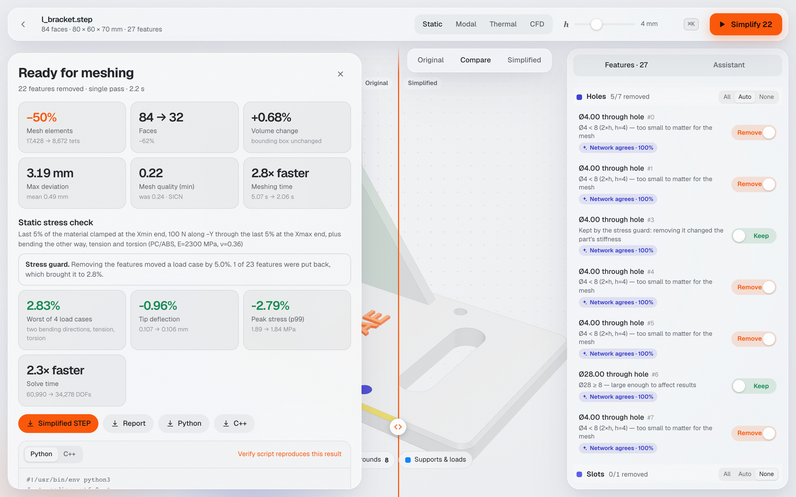
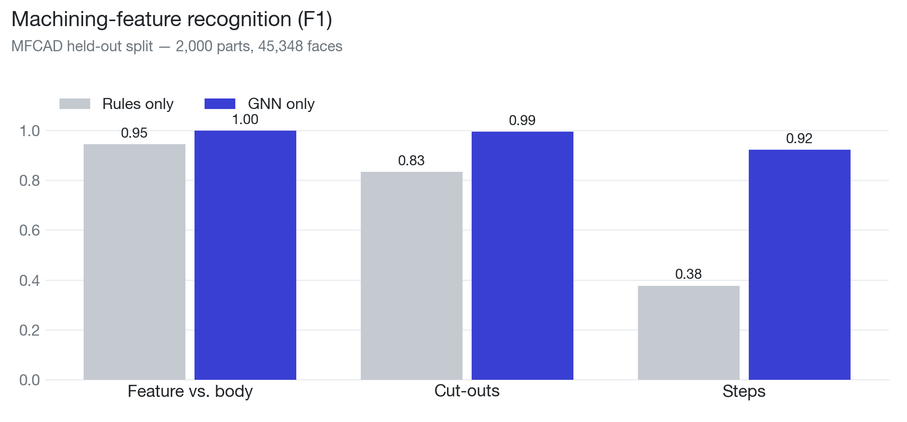
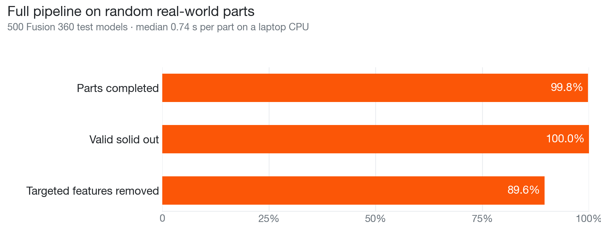

<div align="center">

# DeFeat

### Simulation-ready CAD, in a sentence.

DeFeat takes a mold-part STEP file and finds every hole, slot, pocket, boss, rib, logo, fillet and chamfer.<br>
It decides what matters for your analysis and removes the rest. Then it **proves the result**: both models are meshed and a stress check runs on each.


<picture>
  <source media="(prefers-color-scheme: dark)" srcset="docs/images/welcome-dark.png">
  
</picture>

<sub>The hero is a live dot-matrix render of a real part. Highlighted dots are the features DeFeat will remove; they dissolve away to show the simulation-ready result.</sub>

</div>

## What you get

<table>
<tr>
<td width="50%"><b>Before / after, side by side</b><br><sub>Drag the wipe line to compare the original and simplified model.</sub><br><br>
<picture><source media="(prefers-color-scheme: dark)" srcset="docs/images/compare-dark.png"></picture></td>
<td width="50%"><b>Proof, not promises</b><br><sub>Mesh elements, geometric deviation and a static stress check on both models, plus a STEP, a report and code to download.</sub><br><br>
<picture><source media="(prefers-color-scheme: dark)" srcset="docs/images/results-dark.png"></picture></td>
</tr>
<tr>
<td width="50%"><b>Every feature, explained</b><br><sub>Colour-coded by class, with a plain-English keep/remove reason and a GNN second opinion. Click a chip to isolate a class, or press <kbd>⌘K</kbd> for the command palette.</sub><br><br>
<picture><source media="(prefers-color-scheme: dark)" srcset="docs/images/features-dark.png"></picture></td>
<td width="50%"><b>Talk to your part</b><br><sub>A local open-source LLM turns plain English into exact tool calls. No CAD skills needed, and nothing leaves the machine.</sub><br><br>
</td>
</tr>
</table>

**Outputs:**
- a simplified **STEP**
- an HTML/PDF **report**
- a standalone **Python** script and **C++** program that reproduce the result from the original file. The Python one is round-trip verified.
- an optional CFD **fluid domain**

## Videos

- **Intro** (95 s): `docs/videos/defeat-intro.mp4`
- **Walkthrough** (175 s): `docs/videos/defeat-walkthrough.mp4`

Both are built entirely from code and open models. The narration is [Kokoro](https://github.com/thewh1teagle/kokoro-onnx) (open weights, runs offline). The picture is [Remotion](https://www.remotion.dev), with real 3D parts rendered in three.js. The original 96 BPM score and every sound effect are synthesised in Python. The intro's showcase parts are modelled for the film in `video/parts.py`: a mold cavity plate, gearbox cover, flanged hub, heat sink and robot-arm link, alongside the two samples. `video/export_mesh.py` runs DeFeat on each and exports the original and simplified meshes, so every orange face that lifts away on screen is one DeFeat actually removes. The script and its timing live in `video/plan.json`. `video/score.py` places each line on the bar grid, ducks the music under the voice and writes the timing to `video/src/cues.ts`, so the voice, cuts and captions land on the same frame. To rebuild them:
```bash
cd video
python3.11 -m venv .tts && .tts/bin/pip install kokoro-onnx soundfile   # plus the two model files in video/tts_models/
../.venv/bin/python parts.py && ../.venv/bin/python export_mesh.py       # showcase parts + meshes
.tts/bin/python voice.py && ../.venv/bin/python score.py                 # narration, then score + mix
../.venv/bin/python capture.py                                           # app captures (app running)
npm install && npm run render:intro && npm run render:guide
```

## How it works


| Stage | Module | What it does |
|---|---|---|
| Ingest | `occ.py` | Reads STEP/IGES/BREP, heals the shape with ShapeFix, and indexes faces stably |
| Face graph | `graph.py` | Builds a face-adjacency graph with exact convex/concave/smooth edges (material-side rule on the edge's 2D curve) |
| Rules | `recognize.py` | Inner-loop flood fill finds holes, slots, pockets, bosses and embosses. Concave-edge regions find steps and open channels. Also detects thin-wall ribs and gussets, blend chains and chamfers |
| GNN | `gnn.py`, `datagen.py` | GINE network on pose-invariant face/edge features, trained on generated mold parts plus real labelled CAD (MFCAD, Fusion 360 Gallery). It vetoes or adds fillets/chamfers on top of the rules, with thresholds tuned on validation parts |
| Decide | `decide.py` | Presets for static, modal, thermal and CFD. Thresholds are multiples of the target mesh size *h*, because a feature only hurts the mesh when it's small relative to the elements |
| Execute | `execute.py` | `BRepAlgoAPI_Defeaturing` runs in a killable worker process, so hangs and native crashes are contained. It tries a single pass first, then goes feature by feature. Features are tracked exactly through each removal using the kernel's own history. A refused blend is retried together with its tangent neighbours, then with a fuzzy tolerance |
| Validate | `validate.py`, `fea.py` | Surface deviation, deterministic gmsh meshing of both models at the same *h*, a linear static solve on both meshes (scikit-fem), and a **stress guard** that restores features when deflection moves more than 5% |
| Export | `codegen.py` | Python (OCP) and C++ (OCCT) programs that locate faces by geometric signature |
| Assistant | `agent.py`, `server.py` | Ollama tool calling (`qwen3.5:4b`) with an offline keyword fallback, plus sandboxed text-to-CAD (CadQuery) |

## Benchmarks

Every number below is measured on **held-out test data that was never used for training or tuning**. The raw results are in [`bench/results/`](bench/results/), and every benchmark can be re-run (see *Reproduce*). Hardware: a CPU-only laptop. "Precision" means: of the faces DeFeat flags, how many are right. "Recall" means: of the true feature faces, how many DeFeat finds.

<picture>
  <source media="(prefers-color-scheme: dark)" srcset="docs/images/chart-fusion-dark.png">
  
</picture>

| Fusion 360 Gallery: 1,500 real designer parts | Rules only (P / R / F1) | GNN only | **Shipped: rules + GNN** |
|---|---|---|---|
| Fillets | 0.55 / 0.88 / 0.67 | 0.80 / 0.90 / 0.85 | **0.81 / 0.87 / 0.84** |
| Chamfers | 0.66 / 0.48 / 0.56 | 0.74 / 0.72 / 0.73 | **0.83 / 0.62 / 0.71** |

<picture>
  <source media="(prefers-color-scheme: dark)" srcset="docs/images/chart-mfcad-dark.png">
  
</picture>

| MFCAD: 2,000 machining parts (45,348 faces) | Rules only (P / R / F1) | GNN only |
|---|---|---|
| Feature vs. body | 0.98 / 0.91 / **0.95** | 1.00 / 1.00 / 1.00 |
| Cut-outs (slots, passages, pockets) | 0.85 / 0.84 / 0.84 | 0.99 / 1.00 / 0.995 |
| Steps / shoulders | 0.43 / 0.35 / 0.39 | 0.86 / 1.00 / 0.92 |

- On MFCAD the GNN is near-perfect because MFCAD's parts all come from one generator, so train and test look alike. Fusion 360 is the harder, more honest test.
- MFCAD's "chamfer" class is a large bevel cut, not an edge chamfer, so it isn't scored as a chamfer.
- The rules+GNN thresholds were tuned on 400 separate validation parts.

<picture>
  <source media="(prefers-color-scheme: dark)" srcset="docs/images/chart-robust-dark.png">
  
</picture>

| Full pipeline on 500 random real parts | Result |
|---|---|
| Parts completed | **499 / 500**, one meshing timeout |
| Output is a valid solid | **100%** |
| Targeted features actually removed | **91.1%** (the rest are kept and reported, never broken) |
| Time per part | median 0.5 s, 90th percentile 4.0 s |
| Faces removed / volume change | median 25% / 1.5% |
| Parts within 5% deflection change (stress check, 22 parts meshed and solved) | **90.9% with the stress guard** (59.1% without it) |
| Median deflection change (same 22 parts) | 0.50% (90th percentile 3.8%) |

**Stress guard:**
- **What it does:** when a run moves tip deflection by more than 5%, DeFeat automatically restores the largest removed features in batches and re-checks, until the change is back within tolerance.
- **Measured:** on the 500-part run it triggered 9 times and fixed all 9, restoring a median of 2 features each time.

| Assistant | Local LLM (`qwen3.5:4b`, offline) | Keyword fallback |
|---|---|---|
| 12 held-out commands (tool calls exactly right) | **92%** (call recall 100%, precision 76%) | 67% (precision 100%) |
| 24 development commands | 96% | 96% (tuned on these) |
| Text-to-CAD: 12 part descriptions | 75% valid solids, 58% within 10% of the requested dimensions | n/a |

**Worked examples** (bundled samples):

| Part | Removed | Faces | Tetrahedra | Volume | Deflection Δ | Peak stress Δ (p99) |
|---|---|---|---|---|---|---|
| L-bracket | 23 / 27 | 84 → 31 | **−55%** | +0.83% | −3.0% | +4.8% |
| Printer chassis | 21 / 31 | 261 → 105 | **−42%** | +0.59% | −0.4% | +7.7% |

**Training data:** the GNN (99k parameters) learns from three sources:
- **300 procedurally generated mold parts**
- **3,000 MFCAD training parts**
- **4,000 Fusion 360 Gallery training parts** (fillet/chamfer labels, with a partial-label loss for the other faces)

The rule recognizer isn't trained; it reads exact B-Rep geometry.

## Install

You need **Python 3.10–3.12**. Two things are optional: **Ollama** for the AI assistant, and **Node 18+** (only if you change the web UI, since a built UI is included).

**Windows (PowerShell)**
```powershell
powershell -ExecutionPolicy Bypass -File setup.ps1
.\run.bat
```

**macOS / Linux**
```bash
./setup.sh
./run.sh
```
Linux desktops may also need the OpenGL runtime: `sudo apt install libgl1 libglu1-mesa libxrender1 libxcursor1 libxft2 libxinerama1`.

The app opens at **http://localhost:8000**. For the assistant, install [Ollama](https://ollama.com) and run `ollama pull qwen3.5:4b`. Without it, a keyword mode handles the common commands.

**Batch mode** (whole folders, no UI):
```bash
python -m defeat.cli parts/*.step --preset static --h 3 --out out/
```

**FreeCAD:** run DeFeat from inside FreeCAD with the macro in [`freecad/`](freecad/). Select a part, pick the analysis, and the simplified copy appears next to the original.

**Tests:** `python -m pytest -q tests`. CI runs them on Windows, Linux and macOS.

## Reproduce the benchmarks
```bash
# datasets go in ~/defeat-data (or set DEFEAT_DATA):
#   git clone https://github.com/hducg/MFCAD ~/defeat-data/mfcad
#   Fusion 360 Gallery s2.0.1_extended_step.7z -> ~/defeat-data/fusion_ext/
python -m bench.mfcad --n 2000
python -m bench.fusion --n 1500
python -m bench.robust --n 500 --mesh 80
python -m bench.assistant
python docs/make_charts.py          # regenerate the charts above
python docs/capture.py              # regenerate the screenshots (app must be running)
```

## Limits
- **Steps and shoulders** (open features at a part's edge) are the weakest rule class. Many misses on MFCAD are definitional: for example, its "triangular blind step" is geometrically a closed pocket.
- **Fillet precision** is limited by rounded corners drawn into a sketch. Those are geometrically identical to fillets but labelled as extrusions in the dataset.
- The default presets can still be too aggressive on some parts. The stress guard restores features automatically, but review anything it flags.
- NX files aren't supported (no open-source reader), so export to STEP first.
- The stress check uses linear tetrahedra and an automatic cantilever load case. It's a comparison tool, not a replacement for the real CAE run.
